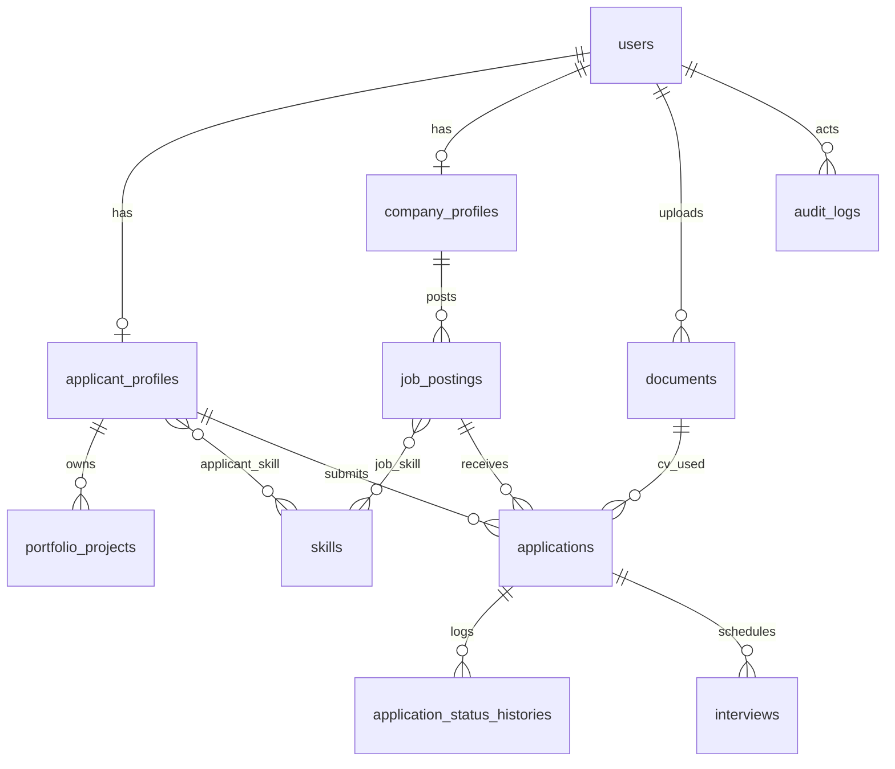

# ERD KarirTI

## Tabel Utama

| Tabel | Keterangan |
|-------|-----------|
| users | Semua pengguna (admin, company, applicant) |
| applicant_profiles | Profil pelamar, termasuk current CV |
| company_profiles | Profil perusahaan + status verifikasi |
| skills | Master skill, pivot ke pelamar dan lowongan |
| portfolio_projects | Proyek portofolio milik pelamar |
| documents | CV PDF tersimpan aman (disk local) |
| job_postings | Lowongan kerja |
| applications | Lamaran dengan status dan cv_snapshot |
| application_status_histories | Jejak setiap perubahan status lamaran |
| interviews | Jadwal interview |
| audit_logs | Log tindakan admin |
| notifications | Notifikasi dalam aplikasi (Laravel standard) |

Lihat `plan.md` Bagian 7.2 untuk detail setiap kolom.
